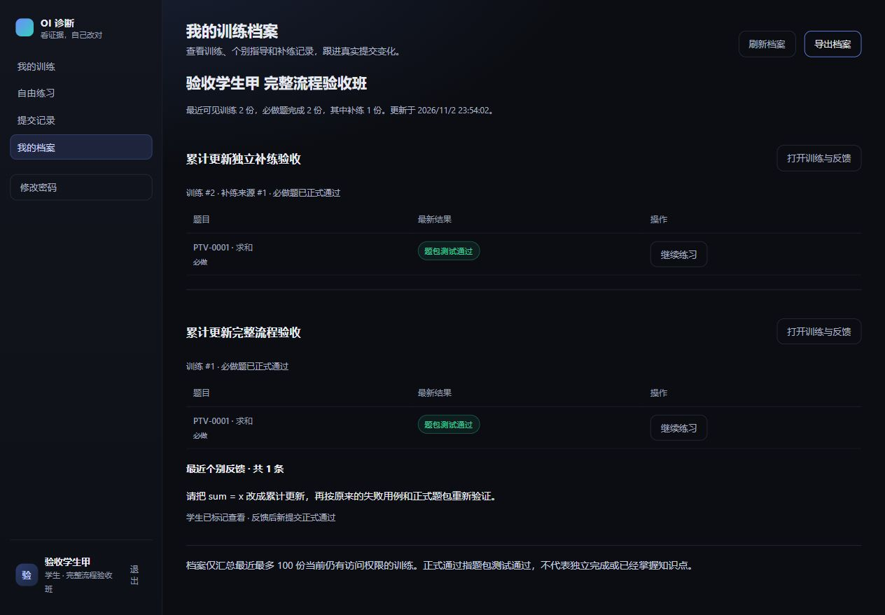
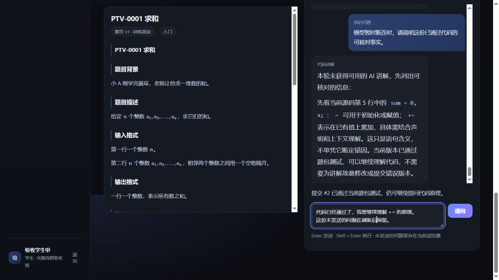

# 三端完整流程与异常验收

日期：2026-11-02—11-03；基线 `99ded3e`。本轮按“完整流程、关键异常”两项验收，使用独立 MySQL 8.4 演示库、独立回归库和专用恢复库。账号、学生名称、源码和训练均为合成材料，没有向业务库写入验收账号。

## 完整流程

| 环节 | 实际操作与结果 |
| --- | --- |
| 管理员准备 | 经管理接口建班、创建教练及两位学生、分班和分配负责教练；新账号通过改密接口完成首次改密；导入自建 `PTV-0001`，核对来源并上架版本 1。 |
| 教练发布 | 页面选正式题包、填写目标、保存预览并发布，名单固定为两位学生。学生只看到自己的完成行。 |
| 初次判题 | 页面提交 `sum = x;` 的 C++17 源码，真实 Docker 判为 WA，正式题包 1/3。 |
| 真实 AI 讲解 | 使用现有 DeepSeek 配置，只分析合成源码；开场及连续两次“不会”共三轮采用模型回复，正确引用第 8 行，说明覆盖与累加，并按要求推演 -5、-1、2；没有循环索要已有输出。 |
| 教练复核与反馈 | 教练依据该提交的执行证据修订说明，原机器结果仍为 WA；同一请求编号并发发送两次反馈，只保存一条。学生在页面明确标为已查看。 |
| 修改核验 | 页面把 `sum = x;` 改为 `sum += x;`，Ctrl＋Enter 重新提交，C++17 正式 3/3；新提交保留父版本关系，原答疑自动核验并显示已解决，仍可追问原理。 |
| 学情和讲评 | 页面显示原训练 2 人中 1 人完成、另一位未提交；先前未通过而最新正式通过计 1 人。模型不可用时生成明确标记的事实提纲，教练编辑为版本 2 后单独发布，学生只读取已发布正文。 |
| 定向补练 | 从指导入口仅指定学生甲发布补练，明确关联原训练；学生乙看不到该训练。学生甲使用 Python3 独立提交，正式 3/3，未复用原题通过状态。 |
| 档案与导出 | 师生档案一致显示 2 份训练、2 份完成、1 份补练；反馈状态为已查看且反馈后新提交正式通过。实际下载 Markdown，核对两份训练及反馈，未附带提交源码。 |
| 管理员备份 | 异步生成加密文件，实际下载并比对 SHA-256，随后在专用空库恢复、逐表比对及清理成功；覆盖复核、答疑、反馈、讲评、固定题目版本和三条真实判题记录。 |

档案截图来自独立合成演示库：

## 异常与恢复

| 场景 | 验证结果 |
| --- | --- |
| 重复点击提交 | 双击提交只创建一条任务；对已完成的相同代码、语言、父记录和训练再次请求，返回同一提交编号。 |
| 判题中刷新 | 从训练继续入口恢复同一提交、代码和执行状态，没有重新创建任务。 |
| 服务在判题中断开 | 强制停止独立测试 API，取消请求无法确认时明确报错，不伪造已取消；重启后原任务被接管，第 2 次尝试完成，证据没有重复写入。 |
| 模型断连 | 独立测试进程注入 HTTP 503，页面明确告知本轮未取得 AI 讲解，仅列可核对事实；不伪装为模型分析。管理员调用记录保留 `http_503`。 |
| 连续说不会 | 真实模型三轮持续读取当前源码与对话，后续逐句展开；没有因重复困惑暂停答疑。 |
| Enter / Shift＋Enter | Enter 发送、Shift＋Enter 只换行；双击提问只产生一条学生消息；成功后清理该份草稿。 |
| 代码换行 | 在 `int main() {` 后换行，自动添加 4 空格缩进；验收后恢复原编辑内容。 |
| 登录失效 | 在独立库撤销学生 token，页面返回登录；重新登录并回到原提交后，代码与两行未发送问题完整恢复。 |
| 跨标签页换号 | 第二个页面登录学生乙后，旧页面要求重新登录；乙看到自己的空编辑器及未提交状态，看不到甲的源码、答疑、反馈、补练和档案；甲重新登录后问题草稿仍在。 |
| 迟到响应 | 前端回归验证：旧页面的发送成功确认不能清掉新页面后来输入的问题，即使正文相同；按草稿版本确认，不按文本去重。 |

刷新后恢复的未发送问题：

## 本轮修复

1. 聊天问题原先只存在组件内存中，登录失效和刷新会丢失。现在按账号和原提交保存本机草稿，保留换行；成功发送只确认并清理对应草稿版本，迟到响应不删除新的输入。存储损坏或不可用不阻断提问。
2. 未定位错因时，分诊说明原先声称“正在进一步取证”“已记录给老师”，完成记录容易被误认为仍有后台操作。新说明明确当前证据边界，也不把未提供范围的通过结论统一写成“样例通过”。已有教师审定不改写。
3. AI 调用记录原先让通用降级原因覆盖 HTTP 故障。现在优先保存网关的实际错误码，缺失时才使用降级原因；不回显服务响应体和凭据，用量未知仍保持未知。

## 回归与环境

- 本地显式启用真实 Docker 的后端全量：**600 passed**；本轮补充的断连记录与分诊专项 **11 passed**。前端 **57 passed**，Ruff、TypeScript、生产构建通过。新增前端回归覆盖草稿恢复、账号/提交隔离、成功确认、迟到响应、损坏缓存及存储失败。
- 真实模型仅用于上述三轮合成代码教学验收；常规回归关闭模型并清空测试进程凭据。断连通过测试替身注入，没有修改业务环境的外部模型开关。
- 本轮无需数据库迁移，仍为 `m7e93da8152b`。本地业务 API 已加载修复，前端仍为 5175；原配置、数据和他人未提交文件保留。
- 临时浏览器页、18002/5297 测试服务、三份独立数据库及下载临时文件已清理。截图仅含合成数据；真实 `.env`、密钥、备份、运行缓存及验收日志均不提交。

重复验收时使用独立库及新的测试浏览器地址，按上表顺序操作；不要向业务库导入合成账号。自动回归按 `AGENTS.md` 的命令执行，数据库测试显式设置独立 `TEST_DATABASE_URL`，真实 Docker 测试通过 `RUN_DOCKER_TESTS=1` 开启。
