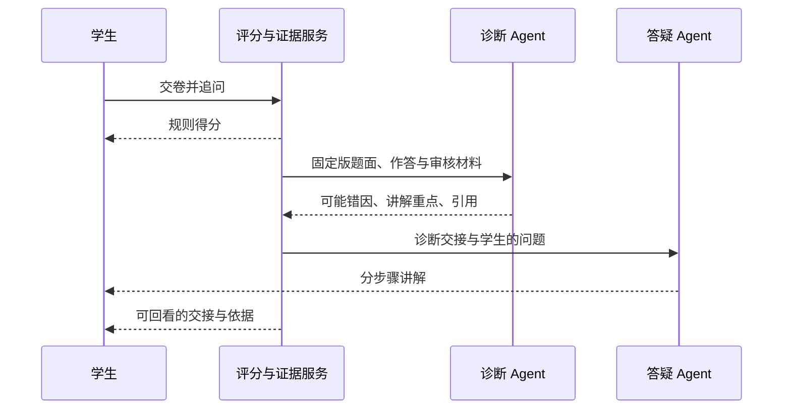

# 初赛三端演示流程

用 [原创演示包](../examples/written/oi-written-demo.zip) 和独立演示班级。准备管理员、教练和学生三个账号。确保教练已分配到演示班级，学生是发布时的启用成员。首页、编程训练与初赛功能共用账号体系。

## 管理员准备两道题和一篇讲义

1. 打开「平台管理 → 初赛题库 → 导入 ZIP 题包」，上传原创包，预览并暂存。包内 J、S 各 8 道。选择「知识点覆盖」，从「二叉树层数与节点数」打开待审题列表。
2. 在两道二叉树题的「审核编辑」逐项核对。多选题的正确选项是 A、B、D。判断题是「错误」。填写答案核对依据，确认教学使用权，审核发布。
3. 打开「初赛知识库 → 新建知识条目」，选择刚导入的题包与「二叉树层数与节点数」。复制[对应讲义及来源](../examples/written/知识条目.md#二叉树层数与节点数)，填写审核说明，发布 v1。
4. 回到题库覆盖表，核对同一知识点的 J 上架数为 2、讲义为 v1。若已发布其它题，学生会在「试卷」看到每卷实际的上架和收录数量。

## 教练发布，学生作答

1. 教练打开「初赛任务 → 发布专项」，选班级和两道二叉树题，发布后查看学情。发布固定名单和审核题面版本。
2. 学生打开「初赛练习 → 班级任务」，第一题只选 A。提交后规则判为答错。点「讲解这道错题」，追问「第 5 层最多 16 个，为什么整棵树是 31 个？」。
3. 展开「查看诊断交接与依据」，可核对本次作答、审核解析及讲义版本。平台 AI 启用时可看到两个角色分别生成的内容，关闭时页面会显示审核解析与关闭原因。
4. 返回同一专项，第二题选择「错误」。进入「学习路线」确认「新题答对」，然后在「知识库」阅读原讲义，并查看文末的同知识点题。
5. 教练刷新学情。该学生应显示已交 2 / 2、答对 1 / 2。另一名未参与的学生应显示两题未交。

## 讲清两个 Agent 的分工

实测示例和调用量见[初赛答疑验收](初赛错题答疑验收.md)。并发表展示的是[本机独立库样本](初赛并发实测.md)。正式素材与原创包分开记录，采集的真题由管理员按实际来源和使用范围审核。

用独立 MySQL 和新的合成班级按上面顺序验收，确认两位角色各收到一次模拟模型请求，讲义 v1 可追溯。学生交卷 2 道、答对 1 道，学习路线记为「新题答对」。教练看到名单中的两位学生，另一位保持未交。
