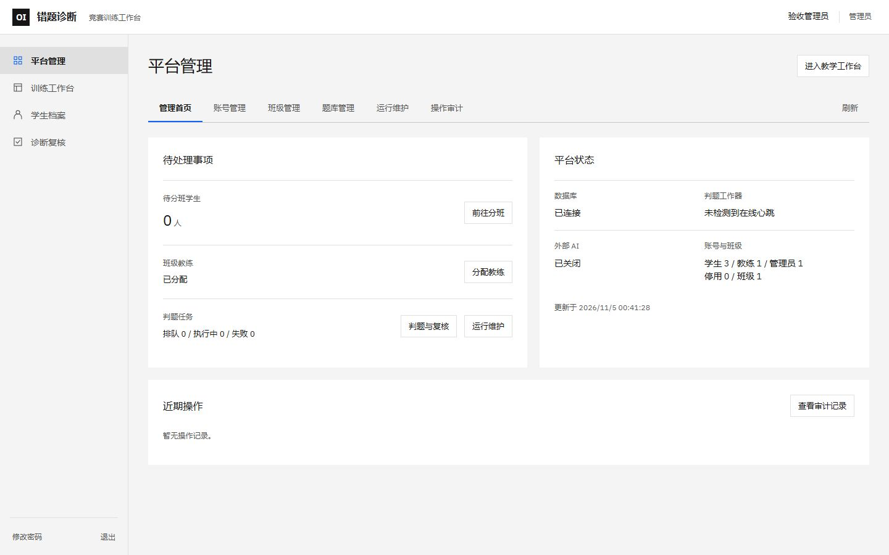
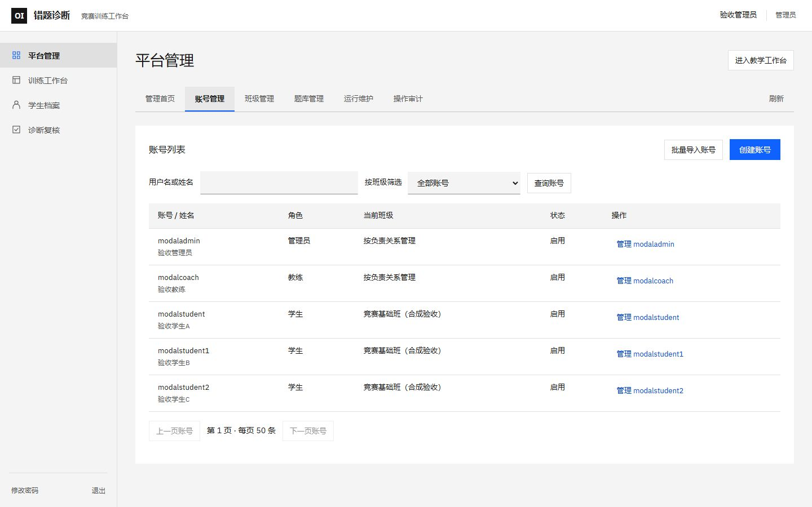
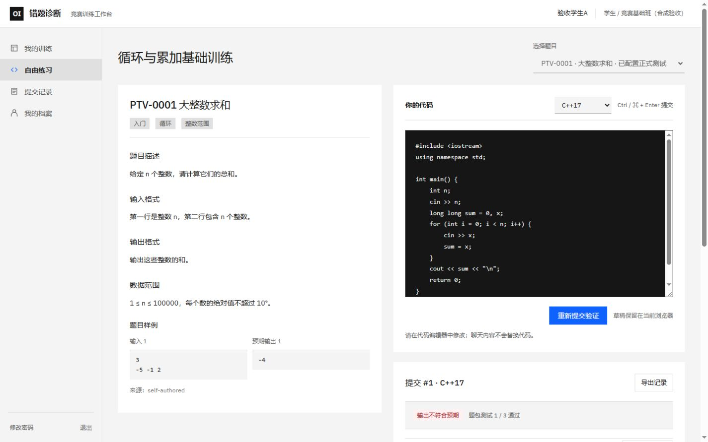

# 前端设计重构验收

日期：2026-11-05。用户要求减少 AI 模板感、删除无用陈述，依据 GitHub Awesome DESIGN.md 重构前端；不改系统功能，本轮只验收电脑端。

## 设计来源与落地

选用 [VoltAgent/awesome-design-md 的 IBM 文档](https://github.com/VoltAgent/awesome-design-md/blob/fcc70284932276d085f01ef9f83edde90b1258cb/design-md/ibm/DESIGN.md)，固定版本、原文及 MIT 许可保存在 `docs/design-reference/`。这是文档合集，不是运行时库，没有安装或执行第三方程序。

采用灰白底色、单一 Carbon 蓝、方形控件和细分隔线，适配既有中文工作台，没有照搬官网营销页。IBM Plex Sans 400/500/600 自托管于 `web/public/fonts/`，保留 OFL 许可；中文回退至系统字体，页面无需请求外部字体服务。

- 登录：删除口号与大幅介绍，保留账号、密码和原有条件式演示账号入口。
- 导航：56px 顶栏、208px 侧栏及统一 SVG 图标，账号信息与工作区分开。
- 管理：状态与待办并列，账号列表、筛选、分页及弹窗统一控件；审计改为紧凑记录。
- 教学：训练列表、完成矩阵、讲评和个别反馈沿用原操作，调整层级和密度。
- 做题：题面与编辑器双栏，代码区保持深色；执行证据、答疑、修改历史保留。
- 文案：删除重复页面介绍、口号和修改起点解释；缩短数学证明、范围与审计的重复陈述。题包/样例边界、权限影响、输入要求、错误和处理中状态仍可见。

## 功能边界

`backend/`、`web/src/api.ts`、编辑器输入处理、消息回执与草稿、核验逻辑均无改动。现有请求、事件处理、权限条件、表单验证和业务状态保持原样。根 `DESIGN.md` 记录实际界面规范，HTML 中的设计合同保留在生产构建中。

## 验证

- 前端测试 **74 passed**，TypeScript 与生产构建通过；保留原有单个大包的构建提示。无新增业务测试或测试数拼接。
- 对本轮 TSX/CSS 运行一次设计检测器，结果 `[]`；差异空白检查通过。
- 使用独立 MySQL、API 18002、前端 5299，常规模型关闭。仅使用合成用户、班级、训练、提交和题目；截图不包含业务数据，不作为诊断准确率或真实判题实验。
- 实际走查：登录退出、账号列表与创建窗口、训练列表及完成矩阵、学生继续练习、题面/源码/执行记录、开启答疑、Shift+Enter 换行及 Enter 发送。原有编辑器缩进及消息边界由既有前端测试覆盖。
- 1440×900 检查无整页横向溢出。独立审阅实际查看六张截图，首轮发现选中页签焦点被覆盖、两段冗余文案；修复后键盘实测焦点为蓝色 2px 轮廓。

最终独立审阅：**PASS**。页签焦点、冗余文案、登录截图完整性三项均 resolved，没有 partial 或 unresolved。两轮内完成检查，不继续扩大样式调整范围。

独立验收服务及数据库已清理。业务 API 18001 和页面 5175 已启动并健康；原模型配置保持不变，已关闭的定时任务保持关闭。其他人的 `scripts/word_import/` 和原目录未提交工作保留。

## 电脑端截图

其他截图：`images/redesign-login.png`、`images/redesign-modal.png`、`images/redesign-teacher.png`。
