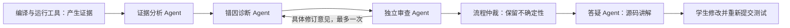

# 多 Agent 协作与缺陷核查

日期：2026-11-04。用户明确课题为“基于多 Agent 协作的青少年信息学竞赛错题诊断与答疑系统”，要求实现真实角色协作，并逐条核对外部 AI 提出的 21 项问题。该报告包含较早版本的信息，以下以当前代码和实际验证为准。

## 协作如何工作

证据分析、诊断和独立审查使用不同的模型请求与职责提示，通过结构化材料交接；可以使用同一模型服务。证据分析只整理观察和缺失信息；诊断提出候选错因；审查重新读取原始材料，可以通过、打回或保留疑问。打回意见和上一轮候选确实进入下一轮诊断输入，不再仅重复运行原函数。最多两轮诊断、五次模型请求，整体预算 60 秒、单次最多 20 秒，网关不在这些节点内额外重试。

确定性的字符或编译问题采用规则快速路径；外部模型关闭、输出无效、超时和独立审查失败分别保留实际状态。未完成的角色不能显示为 AI 已完成分析。模型假设通过独立审查仍需人工核对，不能改变机器判题、自动声称 AC 或推断学生掌握程度。

协作记录保存在诊断的 `model_meta.collaboration`，由原有提交授权保护。学生结果页和教练复核页展示角色、轮次、简要结论、证据编号和修订意见；答疑 Agent 接收这些交接记录及当前授权源码。未通过审查的候选不沿用。只保存简要工作产出，不保存模型隐藏思维过程。

诊断入口在模型调用前取得该诊断的非等待行锁，并按代码、证据摘要、判定和模型配置复用已完成结果。并发重复点击在产生第二份模型费用前返回冲突；降级结果可再次尝试。不同 Agent 的调用分别观察，不把一份多角色请求只记为最后一次调用。

## 真实界面与消息恢复

独立 MySQL、独立 API 18002、代理 18003 与前端 5299，全部使用合成材料和离线 `MockTransport`，未调用付费模型、未向业务库写入验收账号。

- 合成求和案例：第一次诊断给出溢出假设，独立审查依据小整数失败输入指出赋值覆盖；第二轮诊断收到该意见后改为检查 `sum=x`，审查通过。实际界面显示五条角色记录和两轮处理，原 WA 保留。
- 消息接口先真正提交回复，再由验收代理丢弃响应；重试取得回执，但第一次历史读取故意返回 503。前两次失败都保留问题及原请求编号，不追加气泡。第三次同步成功后，仅一条学生消息、两条教师消息（含开场），草稿为空。三次编号相同，回放标记依次为 false、true、true；实际生成答疑仅开场与第一条问题两次。
- 手机 375px DOM 检查无整页横向溢出，五条协作记录仍可读取。截图通道两次分别返回无法截图、CDP 超时，因此本批没有可附加的新截图；不以旧截图冒充。临时页面已关闭，验收文本与代理记录保留在忽略的 `data/run/`。
- 另用 61 份合成提交验证分页：学生列表从 50 条加载至 61 条；教练待复核从 20 条分批加载至 61 条，末页停止显示加载按钮，历史记录仍可打开。

上述案例验证协议、路由和界面恢复，不是模型诊断准确率实验。真实提供商效果仍需固定人工标注集与单 Agent 对照，不能从合成示例推导教学效果。

## 外部报告逐项核查

| 项 | 当前结论与处理 |
| --- | --- |
| 1 环境启动 | PostgreSQL、固定 8000 端口属于旧部署信息。当前目标 MySQL 8.4；开发脚本已有健康等待，本批补 MySQL/Redis 重启策略，修复初始化连接仍带未创建默认库的真实问题。CVAT 属其他项目，只在用户明确允许后临时暂停并在验证后恢复。 |
| 2 常驻 go-judge | 属实。默认 Docker 方式只使用镜像，已将常驻服务设为可选 `gojudge` profile；开发脚本按实际后端选择启动服务或仅检查镜像。 |
| 3 集成测试跳过 | 报告的旧测试数及 PostgreSQL CI 已过时，但默认无测试库时跳过仍是事实。增加显式 `REQUIRE_DATABASE_TESTS=1` 缺配置即失败、CI 强制启用，并在配置示例说明独立测试库。 |
| 4 题包覆盖与样例答疑 | 正式题包覆盖有限，不能把所有题面当作完整评测。学生与教练选题新增实际测试范围标记；样例通过目前也可打开源码讲解，报告所述 `canTutor=false` 已过时。保留正式测试核验要求，不通过人工按钮把样例升级为正式 AC。 |
| 5 待核对历史无出路 | 绑定仍存在但计数/阶段不可信时，可用更新的授权提交重新核验并记录新结果。原绑定完全缺失时明确要求为新提交重新开讲解，不伪造旧关联。读取历史不改原记录。 |
| 6 两套计数校验 | 已在核验中复用 `valid_test_summary`，仍由 `effective_verdict` 统一解释正式/样例/异常计数。 |
| 7 Docker 文件与用户边界 | 已实现固定绝对工作根目录、无特权 UID、运行时只读程序目录、独立状态文件、文件大小/core 限制与有界临时空间。新增只读预览/显式执行的过期缓存清理工具，拒绝越界、过新目录和存在活动判题的清理；旧 cwd 遗留目录不盲删。 |
| 8 MLE 与测量 | 已实现读取 Docker `OOMKilled` 区分真实 OOM 与普通 SIGKILL，测量容器运行墙时并保存时间来源及汇总。墙时包含包装进程开销，不冒充 CPU 时间；未取得可靠峰值内存时仍明确未知。真实容器最终结果见下方验证记录。 |
| 9 同步兼容入口 | 属实，仍需单独将历史同步执行完全任务化。学生界面已使用持久后台任务，且后台去重会忽略没有任务行的旧在途记录；不能因此声称同步接口已具备完整崩溃恢复。本项作为明确余项保留。 |
| 10 心跳异常即停止 | 这是保守的所有权策略。不能简单改为无条件容忍三次，否则可能越过租约继续执行。现有续租和每次写入的令牌检查继续保留；如优化短暂数据库抖动，应先验证租约剩余时间。 |
| 11 全局预算与逐点事务 | 配置确有全局任务上限；“50 个 2 秒测试必然超时”不成立，2 秒是单点上限。大题包的预算配置和证据批量写入仍可优化，本批不以延长所有任务上限替代资源控制。 |
| 12 诊断高成本重复请求 | 已修：模型调用前并发保护，完成结果按输入摘要复用，教师审定仍不可被自动分析覆盖。角色调用分别观察；未新增未经用户配置的付费额度政策。 |
| 13 模型状态公开与探测 | 已修：状态接口要求登录；教师连通检查按账号预留数据库共享的 30 秒窗口，跨 API 进程有效，失效权限重新校验。预留记录不含模型密钥。 |
| 14 SQL 输出敏感参数 | 已关闭全局引擎 SQL echo，并开启隐藏参数，不让调试开关自动输出学生源码和密码哈希。 |
| 15 解决后反复核验 | 已修：仅 open/unverified 接收自动核验；resolved、暂停或不可用状态不因后续提交反复触发。可明确选择讲解本次新提交。 |
| 16 会话 404 卡住 | 当前已有清理旧会话编号并新建的恢复分支，报告基于旧版本，不重复修改。 |
| 17 登录时长 | 15 分钟是可配置策略，不属于必然错误；已具备重新登录后的代码和问题草稿恢复。本批不擅自延长既有部署会话，刷新令牌需单独规划撤销与多标签一致性。 |
| 18 列表与证据分页 | 已为学生提交、教练待复核增加游标及“加载更早”入口，保留归属过滤。单次提交的执行证据仍有题包数量和字段大小边界；证据按用例分页是后续优化，未声称已经完成。 |
| 19 预留设施与死代码 | README 已说明 Redis/MinIO 为预留，掌握度未作为业务评分启用；不把它们当作已使用功能。移除无调用的 `TempId`。 |
| 20 状态数据库约束 | 字符串字段缺少部分 CHECK 的建议成立，但未据此确认发生了非法状态。新增约束须先核对历史取值并做兼容迁移，本批不直接修改历史状态或破坏旧备份。 |
| 21 细节漂移 | 题目限制当前已从固定版本读取，不再写死 1000。已清空重试的旧错误；人工修订不沿用机器评分，显式人工评分标注来源；概览改为轻量流式计数和分组查询，不加载全班源码/完整诊断正文。 |

## 配置与验证入口

迁移：`alembic upgrade head` 到 `n8fa0416c2de`。答疑回执和消息同事务提交；原 m7 加密备份只允许完整旧表集精确补空回执表的唯一兼容路径，新备份包含真实回执，不改原档案及摘要。

显式集成测试在独立库执行：先在测试终端设置 `DATABASE_URL` 与 `TEST_DATABASE_URL` 为同一个独立测试库，再设置 `REQUIRE_DATABASE_TESTS=1`、`LLM_ENABLED=false` 并清空测试进程模型凭据，执行迁移与 `pytest -q`。真实 Docker 回归另加 `RUN_DOCKER_TESTS=1`；不使用业务库测试。

过期目录先预览：`backend\.venv\Scripts\python.exe scripts\clean_judge_cache.py`；核对后加 `--execute`。只清理当前项目固定根目录中至少 24 小时前的专用目录；Docker 状态不明或仍有判题容器时拒绝执行，不遍历原目录、备份、Word 导入及其他项目。

阶段验证：独立 MySQL 全量 **648 passed / 10 条件跳过**；后续运行维护/判题专项 **125 passed / 7 条件跳过**；最新接口/角色/复核/分页与清理专项 **38 passed**，其中修正了新增置信度字段的接口遗漏。前端 **73 passed**，构建与 Ruff 通过。新增执行器、界面分页及题目范围标记后，最终以本批新提交的 CI 和下方真实容器复验为准，不把旧 HEAD 检查当作新代码验证。

真实容器最终复验：用户允许临时暂停 CVAT 后，**13 passed / 31 未选中**，覆盖四语言正式题包、保留退出码、真实超时、真实 OOM、非 root/只读目录/文件限制、NUL 输出取证及 C++ 修改后正式通过。记录在 `data/run/real-resource-isolated.log`。仅恢复原本运行的 16 个 CVAT 容器，逐个确认运行；未重建容器或删除其数据。

同机资源争用环境下此前两轮分别 12 失败/1 通过、6 失败/7 通过，均保留为环境条件下的失败记录；旧版与新版最小程序同机对照也已通过。不能从暂停后的结果声称与 CVAT 共用小内存环境下始终稳定，演示需保留执行器检查和实际资源余量。常规模型测试关闭付费调用，业务环境原有模型配置保留。
