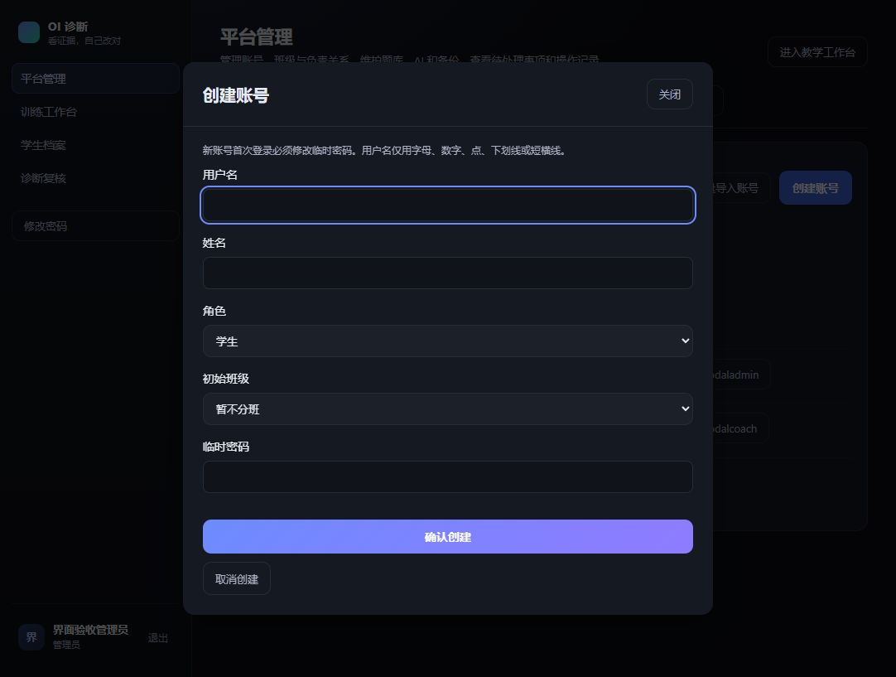
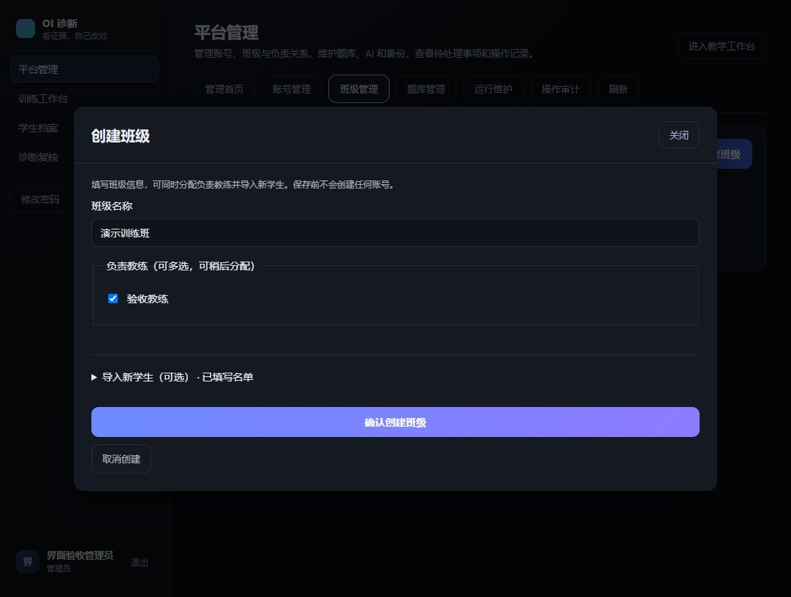

# 管理员端弹窗交互验收

日期：2026-11-04。按用户反馈调整电脑端管理流程：列表用于浏览和筛选，创建、编辑、导入在明确打开的弹窗内完成。本轮不做手机尺寸验收。

## 已调整的入口

| 入口 | 调整后的行为 |
| --- | --- |
| 创建账号 | 点击按钮打开表单，填写用户名、姓名、角色、初始班级及临时密码；失败保留输入，成功刷新列表。 |
| 管理账号 | 编辑设置、重置密码和预览转班影响均位于该账号的管理弹窗。 |
| 批量导入账号 | 点击按钮打开 CSV 导入窗口，选择文件、校验、预览和确认处于同一窗口，取消清空名单及临时密码。 |
| 创建班级 | 名称、负责教练多选和可选的新学生 CSV 名单一起填写。名单先检查再保存，自动加入新班，不要求预先取得班级编号。 |
| 管理班级 | 班名、归档状态、教练和存量训练转交集中在弹窗中；原版本检查与审计保留。 |
| 管理题目 / 导入题包 | 管理、版本记录和导入各有明确弹窗；JSON 校验及确认预览不再散落在列表下方。 |
| 运行维护确认 | 重试 / 取消判题任务、停止外部 AI 使用确认弹窗。日常状态、筛选和 AI 配置保持在相应页面。 |

共用原生 `dialog`，隔离背景操作并锁定背景滚动，支持 Tab 首尾切换及 Escape / 关闭按钮取消。处理请求时禁止重复提交和关闭；错误位于窗口内部并获得焦点。关闭后恢复可用的原入口焦点。文件异步读取有失效标记，关闭窗口后不会回填旧内容；班级名单读取期间不能创建。

## 班级创建的数据边界

`POST /admin/classes` 兼容原有仅传 `name` 的请求，增加可选 `teacher_ids`、`student_accounts`。仅接受启用教练，学生名单必须为未指定班级的新学生，最多 100 人。已有学生继续通过带影响预览的转班流程处理，不在导入中隐式改班。

班级、负责关系、学生账号及脱敏审计在同一事务提交。名单重复、账号已存在、教练无效均拒绝；模拟处理第二名学生时失败，验证班级、第一名学生、负责关系及审计全部回滚。临时密码不写入浏览器存储或审计，无数据库结构迁移。

## 验证结果

- 独立 MySQL，外部模型关闭：管理与运行维护相关 47 项通过；补充中途失败回滚、单账号明确错误后，最新班级创建与账号管理 30 项通过。两组有重叠，不相加。
- 前端 74 项通过，生产构建、相关 Ruff 与差异空白检查通过。最终完整回归查看本批提交对应 GitHub CI。
- 独立浏览器真实操作：账号创建成功 / 重复失败、取消后密码清空、班级选择教练并导入一名学生、列表成员计数、班级及账号编辑窗口、批量导入预览取消、JSON 错误提示、题包预览并确认导入、题目管理、Escape / Tab / 焦点恢复。
- 界面操作只使用合成账号、班级与题目；独立 API 18002、前端 5299 及两个临时测试数据库已清理。业务 API 18001 已加载新代码并健康，页面 5175 保持运行，原 AI 配置未改。

以下截图均来自独立合成验收环境，不包含真实账号或密码。

