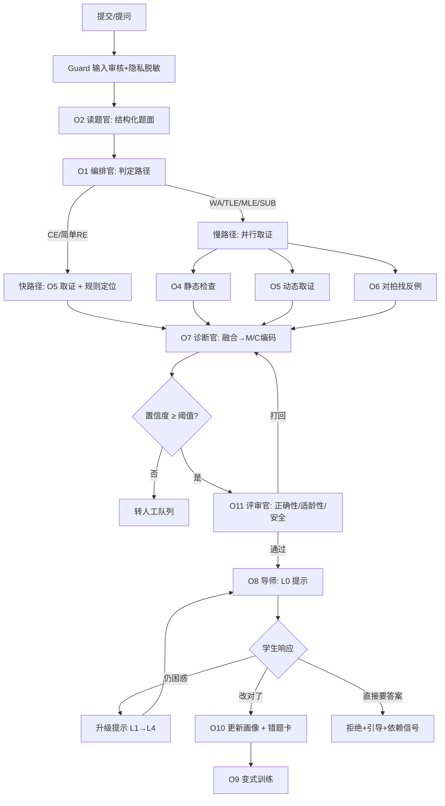
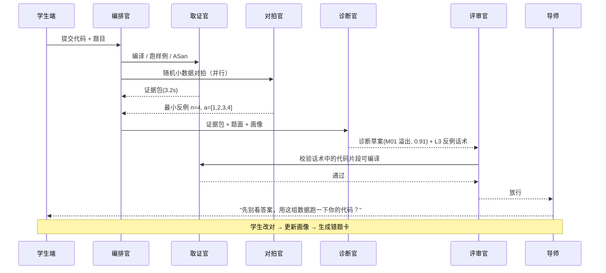

# 青少年信息学竞赛错题诊断与答疑系统 · 需求分析

| 项目 | 内容 |
|---|---|
| 文档版本 | v0.1（需求基线草案） |
| 状态 | 待评审 |
| 适用范围 | 产品立项 / 技术选型 / 毕设开题 |
| 读者 | 产品、教研（教练）、研发、算法、合规 |

> **一句话定位**：把 OJ 上冷冰冰的一个 `WA`，变成一份**有证据、能复现、可教学**的诊断报告，并由多个专职 Agent 分工完成"取证—定因—引导—追踪"的闭环。

---

## 1. 背景与问题定义

### 1.1 领域特征（决定了产品形态）

青少年信息学竞赛（以 CCF NOI 系列活动为主线：CSP-J/S、NOIP、省选、NOI，兼容蓝桥杯等白名单赛事）有三个显著特征，直接塑造了需求：

1. **知识体系陡峭且强依赖**。语法 → 基础算法 → 数据结构 → 算法思想（DP/贪心/搜索）→ 图论/数论/字符串/计算几何。后一个知识点的错误，根因常在前一个环节（"DP 写错"的背后是"状态定义没理解"，再往下是"递归没学透"）。
2. **反馈周期长、错误密度高**。一次机试 3 小时可产生 3~4 道错题，但学生真正弄懂一道题平均需要 1~3 天，教练面批一次只能覆盖个位数学生。
3. **个体差异极大、群体规律极强**。同一个班 40 人，错因分布高度集中在 10~15 类（溢出、越界、多测不清空、复杂度估计错误、边界漏判……）。这意味着**一次高质量的错因归纳，可以被复用给成百上千名学生**——这是本系统最大的杠杆。

### 1.2 三方痛点

| 角色 | 现状 | 真实痛点 | 期望 |
|---|---|---|---|
| **学生**（10~18 岁） | 提交后只看到 `WA on test #7` | 不知道错在哪、为什么错；看题解"看得懂但想不到"；不敢问、怕被说笨；同样的错反复犯 | 有人陪我把这道题弄明白，而不是直接告诉我答案 |
| **教练**（学校/机构） | 一人带 30~100 人，靠微信群和面批 | 无法逐题批改；不知道班级共性薄弱点；重复回答同样的问题；缺少学情数据支撑备课 | 批量看到"谁错了、错在哪类、班级热力图"，把精力放在教学决策上 |
| **家长** | 只看到"AC/WA"和排名 | 无法判断孩子是真会还是抄的；不知道进步在哪；焦虑且容易施压 | 一份看得懂的周报：本周解决了什么、卡在哪、下一步建议 |

### 1.3 现有方案为什么不够

| 方案 | 提供了什么 | 缺什么 |
|---|---|---|
| OJ（洛谷/牛客/校本 OJ） | 判定结果、测试点通过情况 | 只有 verdict，没有**原因**；不解释、不教学 |
| 题解 / 博客 | 正确做法 | 面向"已经会的人"；是**答案**不是**诊断**；不针对"你的代码" |
| 通用大模型对话 | 能讲解、能改代码 | 会**讲错**算法、会**直接给完整代码**（代做）、不了解学生历史、语言不适龄、无证据 |
| 人工答疑 | 质量最高的教学 | 不可规模化、响应慢、质量依赖个人 |

**需求缺口**：市场上不缺"题库"和"题解"，缺的是**把"提交结果"翻译成"认知诊断 + 教学动作"的那一层**。本系统只做这一层，并把它做深。

### 1.4 为什么必须是"多 Agent"，以及它的反模式

单 Agent 的三个硬伤：

- **上下文过载**：题面 + 代码 + 编译日志 + 运行日志 + 学生历史 + 知识库，塞进一个上下文后，模型对细节的注意力显著下降。
- **角色冲突**：同一个提示词既要"严格验证代码正确性"又要"温和鼓励青少年"，两种目标互相稀释，结果是既不够严谨也不够温暖。
- **无法并行取证**：静态检查、编译运行、对拍找反例是三条独立且耗时的路径，串行执行会把时延推到分钟级。

多 Agent 的收益必须落在四件事上，否则就是"角色扮演式伪架构"：

1. **并行取证**（静态 / 动态 / 对拍三路同时跑）
2. **职责隔离**（诊断者不下结论前不许教学；教学者不许改代码）
3. **交叉校验**（Critic 用沙箱和第二个模型驳回幻觉）
4. **按需路由**（简单 CE 走单 Agent 快路径，复杂 WA 才启动全流水线，控成本）

> **设计红线**：Agent 的价值来自"**专有工具 + 明确职责 + 可验证产出 + 仲裁机制**"，而不是角色数量。MVP 阶段建议只落地 5 个角色（见 §12）。

---

## 2. 目标与非目标

### 2.1 产品目标

> 让一名学生在一道错题上，用**最少的提示**、在**一次会话内**、靠自己把代码改对，并让这次错误的根因进入他的长期学情档案。

### 2.2 业务目标（分阶段）

| 阶段 | 目标 |
|---|---|
| 短期 | 替代 60% 的"这题为什么错"重复答疑；教练批改效率提升 3 倍 |
| 中期 | 形成校本错因库与知识图谱，支撑分层教学与个性化训练 |
| 长期 | 沉淀"错因—干预—效果"数据闭环，成为可迁移的教学资产 |

### 2.3 成功度量

**北极星指标**：`引导后独立改对率` = 接受引导的学生中，24 小时内**未经直接给答案**而自主 AC 的比例。

**护栏指标**：诊断准确率、幻觉率、平均提示层级、单次成本、学生挫败信号（连续放弃率）。

### 2.4 非目标（明确不做，防止范围蔓延）

- ❌ 不做 OJ 本身（不重复造评测机，只做对接与增强）
- ❌ 不做直播课/录播课平台
- ❌ 不替代教练做教学决策（系统给建议，人做决定）
- ❌ 不提供"一键代做/直接出正确代码"的能力（默认关闭，见 §4.3）
- ❌ MVP 不做多语言（只支持 C++，竞赛事实标准）

---

## 3. 用户与场景

### 3.1 角色画像

| 角色 | 关键特征 | 系统关注点 |
|---|---|---|
| 学生·入门（小学高年级~初二） | 抽象能力弱、易受挫、注意力 20 分钟 | 具象比喻、短句、正向反馈、单点讲解 |
| 学生·提高（初三~高中） | 有自学能力、时间紧、目标明确 | 精准定位、复杂度分析、策略建议（部分分分配） |
| 教练 | 专业强、时间少、需要批量视图 | 班级热力图、共性问题、可编辑的诊断结论 |
| 家长 | 不懂技术、关注态度与进步 | 非技术化周报、过程性评价、不建议排名施压 |
| 平台管理员 | 负责内容与合规 | 审核队列、审计日志、数据导出与删除 |
| 内容审核员 | 关注不当内容与心理风险 | 拦截队列、人工复核、危机干预流程 |

### 3.2 核心用户故事

| ID | 故事 | 验收要点 |
|---|---|---|
| US-01 | 作为学生，我上传我的代码和题目，系统告诉我"错在哪一类、证据是什么"，而不是直接给答案 | 输出的第一条消息**不含**可直接粘贴的正确代码；包含至少 1 条可复现证据（编译日志/反例/超时数据） |
| US-02 | 作为学生，我可以逐级要提示，每次只多一点点 | 提示必须按 L0→L4 逐级解锁，不能跳级；每次升级需学生先有输入 |
| US-03 | 作为学生，系统给我一个"最小反例"，让我自己跑一遍 | 反例 ≤ 10 行输入，且能稳定复现错误 |
| US-04 | 作为教练，我一眼看到本周全班错误分布，并能下钻到某个学生的某次提交 | 热力图按"机制层错因 × 知识点"聚合，点击可看原始代码与诊断 |
| US-05 | 作为教练，我可以修改 AI 的诊断结论，修正结果回流为训练样本 | 修改留痕、可对比、进入标注集 |
| US-06 | 作为家长，我每周收到一份能看懂的进步报告 | 不含代码；含"本周攻克/仍卡/建议"三块；语言通过可读性检查 |
| US-07 | 作为管理员，我能导出/删除某个学生的全部数据 | 全链路级联删除，含向量库与缓存 |

### 3.3 典型场景走查（Scenario）

**场景 A：一次典型的 WA**

> 小杰（初二）提交 CSP-J 的一道"区间求和"题，`WA on test #5`。他点"诊断"。
> 系统 3 秒内返回：**"你的思路是对的，但在某些数据上会算错。先看这个 4 个数的例子，你手动算一下你的代码会输出什么？"** 并附上反例 `n=4, a=[1,2,3,4]`。
> 小杰跑了一遍，发现输出 `-294967296`——他意识到是 `int` 溢出。系统确认："对，是累加溢出了。那应该改哪里？"
> 他改成 `long long`，AC。系统生成错题卡：「机制层 M01 类型与溢出 · 认知层 C4 习惯缺陷（不估算值域）」，并推送一道 5 分钟的同型变式题。

**场景 B：教练的周一早晨**

> 教练打开班级看板：上周 38 人共 217 次提交，Top3 错因是「多测未清空（41 次）」「二分边界（29 次）」「复杂度估计不足（22 次）」。
> 他据此把周三课的 20 分钟改成"多测清空"专题，并从系统生成的候选变式题中挑了 3 道。

**场景 C：危险的提问**

> 学生问："直接给我代码吧，我赶时间。"
> 系统不直接拒绝，而是："我可以给你关键的那一行。不过先告诉我，你觉得是读入有问题还是计算有问题？"——同时把该学生的"高频代做请求"计入教练端提示（依赖风险信号）。

---

## 4. 领域模型

### 4.1 三层错因体系（系统的核心资产）

诊断不能停留在 `WA`。必须把"表征"下沉到"机制"，再上溯到"认知"，因为**教学干预只发生在认知层**。

**第一层 · 表征层（可直接观测）**

| 编码 | 含义 | 主要取证手段 |
|---|---|---|
| CE | 编译错误 | 编译器诊断信息解析 |
| RE | 运行时错误 | 沙箱退出码 + ASan/UBSan |
| WA | 答案错误 | 对拍 + 反例最小化 |
| TLE | 超时 | 增长实验（n=1e3/1e4/1e5 计时）+ 复杂度拟合 |
| MLE | 内存超限 | 峰值内存采样 |
| PE/OLE | 格式错 / 输出超限 | 输出比对 |
| SUB | 部分分不足 | 子任务通过矩阵 |

**第二层 · 机制层（技术根因，可规则化）**

| 编码 | 机制 | 典型表现 |
|---|---|---|
| M01 | 类型与溢出 | `int` 累加/乘法溢出、`long long` 未开、无符号混用、`scanf("%d", &ll)` |
| M02 | 数组与内存 | 开小一维、下标从 1 却开 `n`、多测未清空、`memset` 尺寸错 |
| M03 | 初始化与 UB | 变量未初始化、野指针、迭代器失效、函数无返回值 |
| M04 | 边界与特判 | `n=1`、空集、全相同、负数、0、极大值 |
| M05 | 循环与终止 | 死循环、递归无终止、深递归爆栈 |
| M06 | 复杂度 | 渐进复杂度选错、常数过大、`cin` 未解绑、STL 误用 |
| M07 | 取模与精度 | 负数取模、浮点误差、整除方向、`double` 比较 |
| M08 | 题意理解 | 读错输入格式、漏条件、输出要求不符 |
| M09 | 算法模型 | 贪心不成立、DP 状态/转移错、图论建模错、二分不单调 |
| M10 | 实现细节 | `sort` 比较器非严格弱序、二分边界、离散化、多关键字排序 |
| M11 | 工程习惯 | 调试输出未删、文件读写、多测格式 |

**第三层 · 认知层（教学靶点，需推断）**

| 编码 | 认知问题 | 对应干预 |
|---|---|---|
| C1 | 概念误解（不知道/混淆） | 补概念 + 具象类比 + 即时检验 |
| C2 | 迁移失败（会模板不会变式） | 变式训练 + 对比辨析 |
| C3 | 策略失误（不会分配时间/不打部分分） | 考试策略教练 + 分段得分训练 |
| C4 | 习惯缺陷（不测样例/不造数据/不查边界） | 检查清单 + 强制自测流程 |
| C5 | 元认知偏差（高估掌握度） | 掌握度校准 + 复述检验 |
| C6 | 状态因素（紧张/疲劳/时间压力） | 归因话术引导 + 教练介入 |

> **关键设计**：机制层由工具**确定性**产出（可复现、可审计），认知层由模型**推断**产出（必须带置信度，低置信度转人工）。二者绝不混淆——这是控制幻觉的结构性手段。

### 4.2 知识图谱（骨架直接采用官方大纲）

以 CCF《NOI 大纲》的入门级 / 提高级 / NOI 级三级知识点为骨架，节点属性包括：

- `id`、名称、层级、所属板块（基础算法 / 数据结构 / 算法思想 / 数学 / 字符串 / 图论 / 计算几何）
- 前置依赖边（构成 DAG，用于根因上溯）
- 常见错因关联（M 编码 → 知识点，先验概率）
- 典型题型、难度（对标 CSP-J/S、NOIP 难度分档）
- 学生掌握度（BKT/IRT 估计，0~1 + 不确定度）

**根因上溯规则**：若学生在"DP 状态设计"上连续失败，且前置节点"递归""状态表示"掌握度 < 0.5，则诊断结论应指向**前置知识缺口**，而非当前知识点。

### 4.3 提示阶梯（Hint Ladder）——防代做的核心机制

| 层级 | 名称 | 给什么 | 不给什么 | 触发条件 |
|---|---|---|---|---|
| L0 | 澄清追问 | "你能说说你的思路吗？" | 任何技术信息 | 默认起点 |
| L1 | 方向提示 | 指向知识点类别（"和整数范围有关"） | 位置、改法 | 学生回答后 |
| L2 | 定位提示 | 指向具体代码段/函数/变量 | 具体改法 | L1 后仍卡住 |
| L3 | 反例提示 | 一个最小反例输入 + "你手动跑一下" | 解释原因 | L2 后仍卡住 |
| L4 | 修正提示 | 具体修改点 / 关键伪代码 | 完整标程 | 连续 2 次无效尝试 |
| L5 | 完整解析 | 完整思路 + 参考实现 | — | **默认关闭**，需教练解锁或申请 |

**硬性规则**：

1. 每次只升一级，不允许跳级；
2. 升级前必须收到学生的新输入（提交新代码 / 回答问题 / 表示放弃）；
3. 单题默认上限 L3；L4 需"两次有效尝试失败"；L5 需教师授权；
4. 同一学生同一知识点 7 天内 L4 出现 ≥ 2 次 → 判定为"高风险依赖"，通知教练；
5. 任何呈现代码的输出，必须通过编译 + 样例验证（见 §6.4 质量闸门）。

### 4.4 核心实体（概念模型）

```
Student 1─n Submission n─1 Problem
Student 1─n WrongCard n─1 KnowledgeNode
Submission 1─n Evidence (编译日志/运行轨迹/反例/计时曲线)
Submission 1─1 Diagnosis 1─n CauseTag(M/C 编码 + 置信度)
Diagnosis 1─n HintSession 1─n HintTurn(level, content, 学生响应)
Student n─n KnowledgeNode (Mastery: 值 + 不确定度 + 更新时间)
Student 1─1 Guardian 1─n Consent (版本/时间/范围)
* ─1 AuditLog
```

---

## 5. 功能需求

> 优先级：**P0** = MVP 必须；**P1** = 首个完整版本；**P2** = 后续增强。

### 5.1 接入与提交（FR-1xx）

| ID | 需求 | 优先级 | 验收要点 |
|---|---|---|---|
| FR-101 | 支持学生粘贴/上传代码（C++），自动识别语言与文件 | P0 | 支持 `.cpp` 上传与纯文本粘贴；语法高亮 |
| FR-102 | 支持手动录入题面（标题、描述、输入输出格式、数据范围、样例） | P0 | 表单校验；支持 Markdown |
| FR-103 | 对接至少 1 个 OJ（优先洛谷/校本 OJ），自动拉取提交记录与判定结果 | P1 | 失败可降级为手动录入；不违反目标站服务条款 |
| FR-104 | 记录提交元数据：时间、耗时、内存、测试点通过矩阵 | P0 | 与 OJ 一致；缺失时标注"不可用"而非编造 |
| FR-105 | 支持批量导入（一班一节课的提交） | P2 | CSV/Excel 模板 |
| FR-106 | 学生端入口：Web + 移动端 H5（微信内可用） | P1 | 移动端核心流程可完成 |

### 5.2 诊断流水线（FR-2xx，核心）

| ID | 需求 | 优先级 | 验收要点 |
|---|---|---|---|
| FR-201 | 编译并解析诊断信息，归类到 M 编码 | P0 | 覆盖 GCC 常见 20 类错误；归类准确率 ≥ 90% |
| FR-202 | 在沙箱中运行代码，采集退出码、stderr、耗时、峰值内存 | P0 | 不可逃逸；单次 ≤ 2s（限制内） |
| FR-203 | ASan/UBSan 插桩运行，定位越界/溢出/未初始化 | P1 | 输出精确到行号；定位成功率 ≥ 70% |
| FR-204 | 对拍：学生代码 vs 暴力/标程，随机小数据找反例 | P1 | 1 分钟内找到反例的比例 ≥ 60%（WA 类） |
| FR-205 | 反例最小化（delta-debugging） | P1 | 输出 ≤ 10 行输入，仍稳定复现 |
| FR-206 | 复杂度估计：多规模计时拟合 + 与题目数据范围对比 | P1 | 能区分 O(n²) 与 O(n log n)；TLE 诊断支持率 ≥ 70% |
| FR-207 | 静态规则扫描（溢出模式、越界模式、比较器、多测清空） | P0 | 规则库可配置；误报可标记 |
| FR-208 | 输出诊断报告：表征 + 机制 + 认知 + 证据 + 置信度 | P0 | 结构化 JSON + 人读版；每结论必带证据或标注"推断" |
| FR-209 | 低置信度自动转人工（教练待办队列） | P0 | 置信度 < 阈值即入队 |
| FR-210 | 部分分归因：根据子任务通过矩阵定位失分档位 | P2 | 需 OJ 提供子任务结果 |

### 5.3 多 Agent 编排（FR-3xx）

| ID | 需求 | 优先级 | 验收要点 |
|---|---|---|---|
| FR-301 | 路由器根据表征层结果选择快/慢路径 | P0 | CE/RE 走快路径；WA/TLE/SUB 走全路径 |
| FR-302 | 支持并行取证（静态 / 动态 / 对拍） | P0 | 并行执行，总时延 ≈ 最慢一路 |
| FR-303 | 每个 Agent 的输入输出契约固定（Schema 校验） | P0 | 不符合 Schema 直接失败而非"猜" |
| FR-304 | 全链路 Trace：每次调用记录 prompt/模型/耗时/token/结果 | P0 | 可按 submission_id 回放 |
| FR-305 | 预算控制：单次诊断的 token/时间上限，超限降级 | P0 | 降级后仍输出部分结论 |
| FR-306 | 模型可替换（多模型路由 + 灰度） | P1 | 配置化，不需改代码 |
| FR-307 | 人工可中断/接管 | P1 | 教练可暂停流水线并接管对话 |

### 5.4 分层答疑与引导（FR-4xx）

| ID | 需求 | 优先级 | 验收要点 |
|---|---|---|---|
| FR-401 | 按 §4.3 实现提示阶梯状态机 | P0 | 跳级请求被拒绝并解释原因 |
| FR-402 | 话术适龄化：按学段调整术语密度、句长、比喻 | P0 | 小学生版不含未解释术语；可读性指标达标 |
| FR-403 | 苏格拉底式追问：优先提问而非陈述 | P1 | 首轮回复中问句占比 ≥ 40% |
| FR-404 | 情绪识别与安抚：挫败/焦虑信号触发支持性话术 | P1 | 不当话术 0 容忍（见 NFR-S） |
| FR-405 | 危机干预：识别极端负面表达 → 停止技术答疑，提示真人介入 | P0 | 24h 内通知教练/家长（按预案） |
| FR-406 | 多轮记忆：同一题内的对话上下文；跨题仅带画像摘要 | P0 | 上下文超限时按策略裁剪 |
| FR-407 | 学生复述检验（费曼式）：让学生用自己的话总结 | P2 | 生成复述题并评估 |
| FR-408 | 语音输入/手写草稿识别 | P2 | 辅助低龄学生表达 |

### 5.5 变式训练与推荐（FR-5xx）

| ID | 需求 | 优先级 | 验收要点 |
|---|---|---|---|
| FR-501 | 基于错因生成/检索同类变式题（1~3 道） | P1 | 知识点匹配 + 难度略降；附推荐理由 |
| FR-502 | 变式题需经正确性校验（题面自洽 + 有解 + 样例正确） | P1 | 生成题必须通过校验 Agent |
| FR-503 | 间隔重复复习计划（简化 SM-2） | P2 | 按掌握度安排复习 |
| FR-504 | 训练效果回写掌握度 | P1 | 变式题 AC/失败更新图谱 |

### 5.6 学情画像与报告（FR-6xx）

| ID | 需求 | 优先级 | 验收要点 |
|---|---|---|---|
| FR-601 | 知识点掌握度模型（BKT 或 IRT），带不确定度 | P1 | 每节点 0~1 + 置信区间 |
| FR-602 | 错题卡自动生成（题面摘要、错因、正解要点、复盘问题） | P0 | 可导出 PDF/Markdown |
| FR-603 | 个人周报：攻克 / 仍卡 / 建议 | P1 | 数据可追溯到具体提交 |
| FR-604 | 家长版周报（非技术语言） | P1 | 无代码、无排名施压话术 |
| FR-605 | 学习路径建议（下一步学什么） | P2 | 基于图谱前置关系 |

### 5.7 教练工作台（FR-7xx）

| ID | 需求 | 优先级 | 验收要点 |
|---|---|---|---|
| FR-701 | 班级错因热力图（机制层 × 知识点） | P1 | 支持下钻到学生/提交 |
| FR-702 | 待人工复核队列（低置信度 + 高风险） | P0 | 支持一键采纳/修改/驳回 |
| FR-703 | 批量查看学生代码与诊断并排对比 | P1 | 代码 diff 高亮 |
| FR-704 | 共性错因 → 一键生成专题课素材（例题 + 变式 + 讲解要点） | P2 | 输出可编辑 |
| FR-705 | 教练修改结论回流标注集 | P1 | 留痕、可统计一致性 |

### 5.8 内容与知识库（FR-8xx）

| ID | 需求 | 优先级 | 验收要点 |
|---|---|---|---|
| FR-801 | 题库管理（题面、数据、标程、暴力解、难度、知识点标签） | P0 | 支持导入导出 |
| FR-802 | 题解/教材知识库（RAG），带出处与版本 | P0 | 回答可溯源到片段 |
| FR-803 | 错因知识库（每类错因的讲解模板、典型例子、话术） | P0 | 教研可维护 |
| FR-804 | 内容审核与上下架 | P1 | 双人复核 |

### 5.9 安全合规（FR-9xx）

| ID | 需求 | 优先级 | 验收要点 |
|---|---|---|---|
| FR-901 | 监护人同意流程（不满 14 周岁强制） | P0 | 记录同意版本、时间、范围；未同意不可用 |
| FR-902 | 数据导出与删除（学生/家长申请） | P0 | 级联删除，含向量库、缓存、备份策略说明 |
| FR-903 | 输出内容审核（不当内容、歧义、歧视、打击性话术） | P0 | 拦截率 100%（抽样复核） |
| FR-904 | AI 生成内容标识 | P1 | 界面显式标注"AI 生成，请核对" |
| FR-905 | 防代做策略可配置（按学段/按场景） | P0 | 教练可调严 |
| FR-906 | 审计日志（谁在何时看了谁的代码） | P1 | 不可篡改，保留 ≥ 6 个月 |

### 5.10 评测与运营（FR-10xx）

| ID | 需求 | 优先级 | 验收要点 |
|---|---|---|---|
| FR-1001 | 离线评测集管理（真实错题 + 人工标注错因） | P0 | ≥ 500 条，覆盖 5 类 verdict × 3 难度 |
| FR-1002 | 回归测试：每次 prompt/模型变更自动跑评测 | P0 | 指标下降超阈值则阻断发布 |
| FR-1003 | 线上抽检（每日 N 条人工复核） | P0 | 形成 badcase 库 |
| FR-1004 | A/B 实验框架（提示策略、模型） | P2 | 分流 + 指标看板 |

---

## 6. 多 Agent 协作设计

### 6.1 角色矩阵

| 代号 | 角色 | 职责 | 关键工具 | 产出 | 失败降级 |
|---|---|---|---|---|---|
| O1 | **编排官** Orchestrator | 路径选择、预算分配、状态推进 | 规则引擎 + 轻量分类器 | 任务计划 DAG | 退化为固定全流程 |
| O2 | **读题官** Parser | 抽取题意、IO 格式、数据范围、知识点 | RAG（NOI 大纲）、题库 | 结构化题面 JSON | 用原文 + 人工补 |
| O3 | **代码理解官** Reader | AST/控制流、变量用途、可疑段定位 | tree-sitter / clang | 代码地图 + 行号锚点 | 粗粒度定位 |
| O4 | **静态检查官** Inspector | 规则匹配（溢出/越界/比较器/多测） | clang-tidy + 自研规则 | 告警列表（带置信度） | 空结果 |
| O5 | **取证官** Prober | 编译、跑样例、ASan/UBSan、计时、内存 | 沙箱 | 证据包 | 仅编译日志 |
| O6 | **对拍官** Hunter | 生成数据、对拍、反例最小化 | 数据生成器、暴力解 | 最小反例 | 跳过并标注 |
| O7 | **诊断官** Diagnostician | 融合证据 → M/C 编码 + 置信度 | 证据包、错因库 | 诊断报告 | 低置信 → 转人工 |
| O8 | **导师** Tutor | 分层提示、适龄化话术 | 提示模板、学生画像 | 提示序列 | 模板化提示 |
| O9 | **变式教练** Trainer | 变式题生成/检索、训练计划 | 题库、图谱 | 训练包 | 仅推荐原题 |
| O10 | **学情分析师** Profiler | 掌握度更新、周报 | 图谱、BKT | 画像增量 | 简单计数 |
| O11 | **评审官** Critic | 正确性/适龄性/安全性校验、冲突仲裁 | 沙箱、第二模型、规则 | 通过 / 打回 + 理由 | 打回并转人工 |
| O12 | **安全官** Guard | 内容审核、隐私脱敏、防代做、情绪风险 | 审核模型、规则 | 放行 / 拦截 | 保守拦截 |

> **工程建议**：O4/O5/O6 可以是**确定性工具**而非 LLM；O1、O11 可以是同一模型的不同调用。真正的 LLM Agent 控制在 4~6 个，其余是"工具节点"。这样成本与稳定性都可控。

### 6.2 编排流程



### 6.3 一次 WA 诊断的时序（慢路径）



### 6.4 质量闸门（幻觉防线，硬性 NFR）

| 闸门 | 规则 | 失败处理 |
|---|---|---|
| G1 Schema 校验 | 每个 Agent 输出必须符合 JSON Schema | 重试 1 次 → 失败则降级 |
| G2 代码可编译 | 任何呈现给学生的代码片段必须编译通过 | 回退为自然语言描述 |
| G3 样例通过 | 声称"这样改就对了"的代码必须过样例 | 禁止输出该结论 |
| G4 证据绑定 | 机制层结论必须绑定至少 1 条证据 ID | 降级为"推断"并降低置信度 |
| G5 适龄性 | 术语密度/句长/负面词检查 | 重写 |
| G6 安全 | 内容审核 + 防代做规则 | 拦截并记录 |

> **可验证的产品承诺**：*系统不会输出未经编译验证的代码*。这是与"通用聊天机器人"最本质的差异。

### 6.5 成本与时延路由

| 路径 | 适用 | Agent 数 | 目标 P95 时延 | 目标成本 |
|---|---|---|---|---|
| 快路径 | CE、简单 RE（越界/除零） | 2~3 | ≤ 8s | ≤ ¥0.05 |
| 标准路径 | WA（有反例即可定位） | 4~5 | ≤ 45s | ≤ ¥0.3 |
| 全路径 | TLE / 复杂 WA / 需要模型推断 | 6~8 | ≤ 120s | ≤ ¥1.2 |
| 闲聊/概念问答 | "什么是并查集" | 1 | ≤ 5s | ≤ ¥0.02 |

优化手段：结果缓存（同题同错因）、小模型分流、证据复用（同一题多次提交）、异步化（先给"正在取证"占位）。

### 6.6 失败与降级矩阵

| 故障 | 影响 | 降级策略 |
|---|---|---|
| 沙箱不可用 | 无法取证 | 只做静态分析，明确告知"未验证" |
| 对拍超时 | 无反例 | 给方向性提示（L1） |
| 模型超时/限流 | 无法生成 | 返回模板化诊断（按 M 编码） |
| 置信度低 | 可能误诊 | 转人工 + 告知学生"已请教练看" |
| 评审反复打回 | 无法收敛 | 直接转人工，记录 badcase |

---

## 7. 非功能需求

| ID | 类别 | 要求 |
|---|---|---|
| NFR-P1 | 性能 | 首字节 ≤ 3s（先给"正在诊断"与初步判断）；快路径 P95 ≤ 8s；全路径 P95 ≤ 120s |
| NFR-P2 | 并发 | 单校 50 人同时提交不降级；支持水平扩展 |
| NFR-P3 | 沙箱 | 隔离 CPU/内存/进程/网络/文件系统；单次限时 ≤ 2s、限存 ≤ 512MB；防 fork 炸弹 |
| NFR-R1 | 可用性 | 核心诊断链路 99.5%（学期内），非学期可降级 |
| NFR-R2 | 幂等 | 同一提交重复诊断结果一致（可复现性） |
| NFR-R3 | 数据 | 每日备份；RPO ≤ 24h，RTO ≤ 4h |
| NFR-S1 | 安全 | 代码仅在沙箱执行；传输 TLS；静态加密；密钥托管 |
| NFR-S2 | 隐私 | 最小化采集；手机号/姓名脱敏后入模型上下文；不向境外模型传输未成年人数据 |
| NFR-S3 | 合规 | 遵循《个人信息保护法》（第 31 条监护人同意）、《未成年人网络保护条例》、《生成式人工智能服务管理暂行办法》、《人工智能生成合成内容标识办法》、《儿童个人信息网络保护规定》；对外服务需完成相应备案（**需法务确认**） |
| NFR-S4 | 内容 | 零容忍：侮辱、歧视、制造焦虑、诱导沉迷；AI 生成内容显式标识 |
| NFR-O1 | 可观测 | 全链路 Trace、Agent 级指标（成功率/时延/成本/打回率）、badcase 看板 |
| NFR-M1 | 可维护 | Prompt 与规则配置化、版本化；支持灰度与一键回滚 |
| NFR-M2 | 可评测 | 离线评测集 + 回归流水线；指标下降自动阻断发布 |
| NFR-C1 | 成本 | 单次诊断平均 ≤ ¥0.3；月度成本可预测、可配额 |
| NFR-X1 | 扩展 | 新增 OJ / 新增语言 / 新增赛事大纲不改核心编排 |
| NFR-A1 | 无障碍 | 移动端可用；字号可调；低带宽可用（文本优先） |

---

## 8. 数据需求

### 8.1 数据来源

| 来源 | 内容 | 获取方式 | 风险 |
|---|---|---|---|
| 学生提交 | 代码、时间、判定 | 上传 / OJ 对接 | 隐私 |
| 题面与数据 | 题目、测试点 | 自建题库 / 授权引入 | **版权**（严禁爬取受版权保护的题面与数据） |
| 教练标注 | 错因金标 | 工作台标注 | 人力成本 |
| 公开题解/教材 | 知识片段 | 授权 / 自撰 | 版权、时效 |
| 交互日志 | 提示层级、学生响应 | 系统埋点 | 隐私 |

### 8.2 数据质量与冷启动

- **冷启动三招**：① 教练标注 200~300 条真实错题作为种子评测集；② 用规则+工具自动生成机制层标签（不依赖 LLM）；③ 合成数据仅用于"反例生成器"训练，不用于评测。
- **标注规范**：双人标注 + 分歧仲裁，Kappa ≥ 0.7 才可用于评测。
- **闭环**：教练修改 → 差异分析 → 更新规则/提示模板 → 回归评测。

### 8.3 数据保留

| 数据 | 保留期 | 说明 |
|---|---|---|
| 代码与提交 | 学期 + 1 年（可配） | 到期匿名化 |
| 对话记录 | 180 天 | 用于改进，可申请删除 |
| 画像 | 学习期内 | 删除账号即删 |
| 审计日志 | ≥ 6 个月 | 合规要求 |

---

## 9. 约束与假设

| 类型 | 内容 |
|---|---|
| 技术约束 | 只支持 C++（C++14/17）；沙箱需 Linux（Windows 开发环境需容器或远程执行） |
| 数据约束 | OJ 无公开 API 时只能手动录入；测试点信息常不可见 |
| 组织约束 | 需教研（教练）深度参与，否则错因库无内容 |
| 合规约束 | 未成年人数据不得出境；对外服务需备案与内容标识 |
| 假设 | 学生愿意上传代码；教练愿意标注；学校允许使用外部 AI 服务（或私有化部署） |
| 假设 | 单题诊断的边际成本可被学费/课时费覆盖 |

---

## 10. 风险与对策

| # | 风险 | 影响 | 概率 | 对策 |
|---|---|---|---|---|
| R1 | **模型讲错算法/给出错误代码** | 高（毁信任） | 高 | 质量闸门 G2/G3 强制编译验证；Critic 用第二模型交叉；机制层结论必须绑证据 |
| R2 | **学生依赖，直接要答案** | 高（教育价值反转） | 高 | 提示阶梯 + L5 默认关闭 + 依赖信号上报 + 教练可调严 |
| R3 | **OJ 数据拿不到** | 中（功能受限） | 高 | MVP 先做手动录入；与校本 OJ 合作 |
| R4 | **评测集缺失，无法证明有效** | 高（无法迭代） | 中 | 立项即建 500 条金标；教练标注纳入工作量 |
| R5 | **多 Agent 成本/时延失控** | 中 | 中 | 路由 + 缓存 + 小模型 + 预算上限 |
| R6 | **题目/题解版权** | 高（法律） | 中 | 只用授权题与自命题；不爬取 |
| R7 | **未成年人隐私与合规** | 高（法律） | 中 | 监护人同意、最小化、境内模型、审计 |
| R8 | **低龄学生表达困难，诊断偏差** | 中 | 中 | 追问式澄清 + 多模态输入 + 教练兜底 |
| R9 | **教练不信任、不使用** | 高（落地失败） | 中 | 教练可修改结论；先做"减负"功能（批改助手）而非"替代" |
| R10 | **心理安全事件** | 高 | 低 | 危机识别 + 人工介入预案 + 话术红线 |

---

## 11. 验收与评测

### 11.1 上线门槛（Go/No-Go）

| 指标 | 定义 | 门槛 |
|---|---|---|
| 诊断 Top-1 准确率 | 与教练标注的主错因一致 | ≥ 75% |
| 诊断 Top-3 覆盖率 | 正确错因出现在前三 | ≥ 90% |
| 证据覆盖率 | 机制层结论附带可复现证据的比例 | ≥ 80% |
| 代码幻觉率 | 呈现给学生的代码不可编译/不正确 | = 0（闸门拦截后） |
| 引导后独立改对率 | 24h 内未获 L5 而自主 AC | ≥ 50% |
| 平均提示层级 | 首次有效提示的平均 L 值 | ≤ 2.0 |
| 学员满意度 | 5 分制 | ≥ 4.2 |
| 教练采纳率 | 诊断结论未修改直接采纳 | ≥ 70% |
| P95 时延 / 单次成本 | 见 §6.5 | 达标 |

### 11.2 评测集设计

- 规模：≥ 500 条真实提交（MVP 期 150 条可先跑通）
- 分层：`verdict`（CE/RE/WA/TLE/MLE）× 难度（J 组/ S 组/ NOIP）× 知识板块（6 类）
- 每条含：代码、题面、期望 M 编码、期望 C 编码、期望首个提示层级、可接受话术样例
- 评测方式：自动指标 + 人工盲评（每条 2 人，Kappa ≥ 0.7）

### 11.3 线上监控

- 每日抽检 30 条 → badcase 库
- 学生"没看懂"反馈率（消息级点赞/点踩）
- 放弃率（发起诊断后未进行任何后续交互）
- 依赖信号（L4/L5 请求频次、代做请求频次）

---

## 12. 版本规划

| 版本 | 周期 | 范围 | 退出标准 |
|---|---|---|---|
| **MVP** | 8~10 周 | 手动录入题目与代码；CE/RE/WA 诊断（规则 + 沙箱 + 样例）；L0~L3 提示；错题卡；单 Agent + 3 工具 | 20 名学生试用 2 周，诊断准确率 ≥ 70%，独立改对率 ≥ 40% |
| **V1** | +10 周 | 对拍 + 反例最小化；ASan/UBSan；知识图谱画像；教练工作台；家长周报；变式推荐；5 Agent 编排 | 一个班完整学期使用，教练采纳率 ≥ 70% |
| **V2** | +12 周 | 多 OJ 对接；批量导入；专题课素材生成；间隔重复；A/B 框架；私有化部署 | 3 所学校落地，成本达标 |
| **V3** | 待定 | 语音/手写；多语言；跨学科迁移（数学/物理错题诊断） | — |

**MVP 的取舍理由**：先证明"诊断准不准"，再证明"教得好不好"，最后才做"规模化"。CE/RE 是最容易用确定性工具做准的场景，适合作为质量基线。

---

## 13. 开放问题（需业务方拍板）

1. **目标范围**：只做 CSP-J/S，还是覆盖到 NOIP/省选？（决定知识图谱与难度分层的工作量）
2. **部署形态**：SaaS 多租户 / 单校私有化 / 混合？（决定合规与成本模型）
3. ~~**是否自建 OJ**：若不建，题目与数据从哪来？~~ **已决**：不自建 OJ；题库三层隔离（自命题 + 公开数据集 + 元数据），详见 [题库与数据源调研](题库与数据源调研.md)。**结论：中文 CSP 真题无合法再分发来源，L1 必须自命题或校内共建。**
4. **模型选型**：境内商用 API / 开源自部署？（决定数据出境与成本）
5. **教师角色**：AI 结论是否必须教师审核后才可见？（决定时延与人力）
6. **收费对象**：学校 / 机构 / 家长？（决定功能优先级：教练端 vs 家长端）
7. **是否允许 L5**：什么条件下允许完整题解？（教育理念问题）

---

## 附录 A · 术语表

| 术语 | 含义 |
|---|---|
| AC / WA / CE / RE / TLE / MLE / PE | 通过 / 答案错 / 编译错 / 运行时错 / 超时 / 超内存 / 格式错 |
| Subtask | 子任务，按数据规模或特殊性质分档给分 |
| 对拍 | 用暴力解与待测程序在随机数据上比对输出 |
| delta-debugging | 自动缩小失败输入的最小化算法 |
| ASan / UBSan | 地址/未定义行为检测器，可精确定位越界与溢出 |
| BKT / IRT | 贝叶斯知识追踪 / 项目反应理论，掌握度建模方法 |
| ZPD | 最近发展区，教学难度应略高于当前水平 |
| Hint Ladder | 提示阶梯，逐级增加帮助量 |

## 附录 B · 错因编码速查

`M01 溢出 · M02 数组 · M03 初始化 · M04 边界 · M05 循环 · M06 复杂度 · M07 取模精度 · M08 题意 · M09 模型 · M10 实现细节 · M11 工程习惯`
`C1 概念 · C2 迁移 · C3 策略 · C4 习惯 · C5 元认知 · C6 状态`

## 附录 C · 若作为毕设 / 课程项目的裁剪建议

> **本项目最终定位**：以**毕业设计**形式交付，但按**可落地产品**的工程标准做——一台机器能跑、一个班能真用、简历能站住。因此下表"保留"列全做，"裁剪"列只做接口预留（详见 [系统架构设计](系统架构设计.md) 与 [开源项目调研](开源项目调研.md)）。

| 保留（体现工作量与创新） | 裁剪（避免做不完） |
|---|---|
| 三层错因体系 + 编码表 | 多 OJ 对接 |
| 沙箱取证 + 对拍 + 反例最小化（**最亮的点**） | 家长端、支付、多租户 |
| 4~5 个 Agent 的编排与仲裁 | 12 个角色的完整实现 |
| 提示阶梯状态机 + 适龄化 | 语音/手写多模态 |
| 150 条金标评测集 + 指标对比实验 | 大规模用户增长 |

> 毕设的"创新点"建议表述为：**以可验证证据为约束的多 Agent 诊断框架**——即用确定性工具（编译/沙箱/对拍）为 LLM 的诊断结论提供证据锚点，并用评审 Agent 做闭环校验，从而把"AI 讲题"从不可靠的生成式问答，变成可审计的教学行为。

## 附录 D · 参考依据（需复核最新版本）

- CCF《全国青少年信息学奥林匹克系列竞赛大纲》（NOI 大纲）
- 《中华人民共和国个人信息保护法》第 31 条（不满十四周岁未成年人）
- 《未成年人网络保护条例》（2024-01-01 施行）
- 《生成式人工智能服务管理暂行办法》（2023-08-15 施行）
- 《人工智能生成合成内容标识办法》（2025-09-01 施行）
- 《儿童个人信息网络保护规定》
